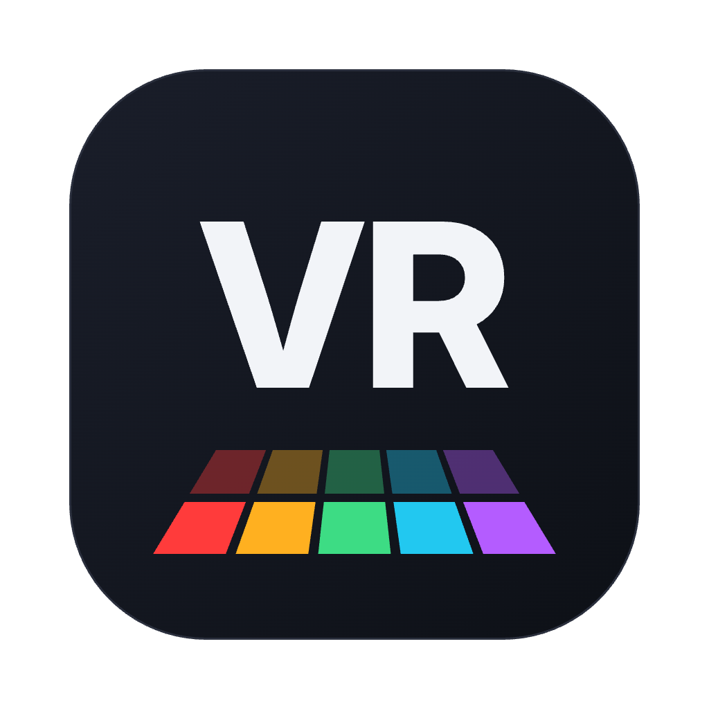
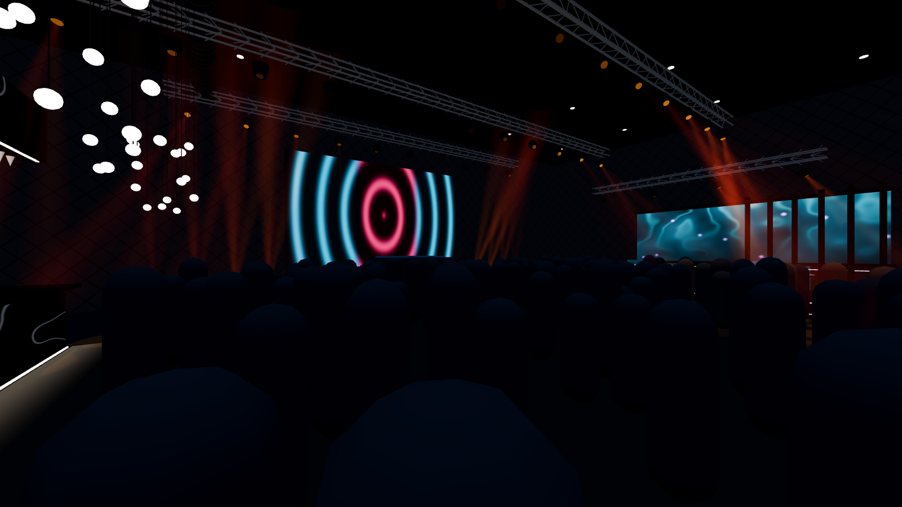
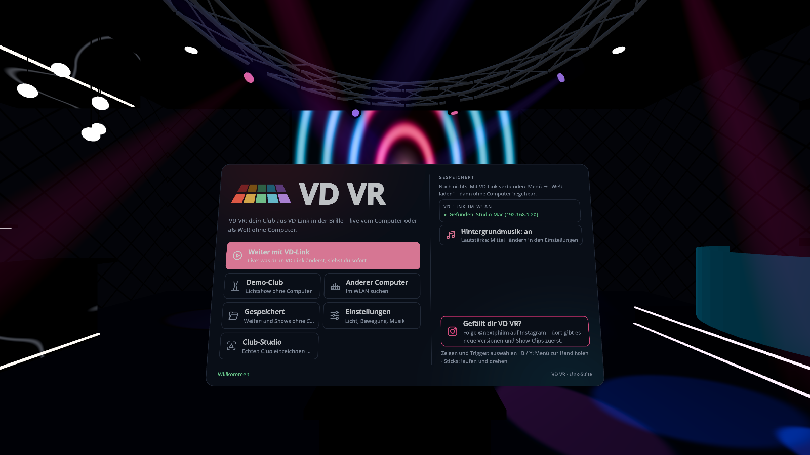
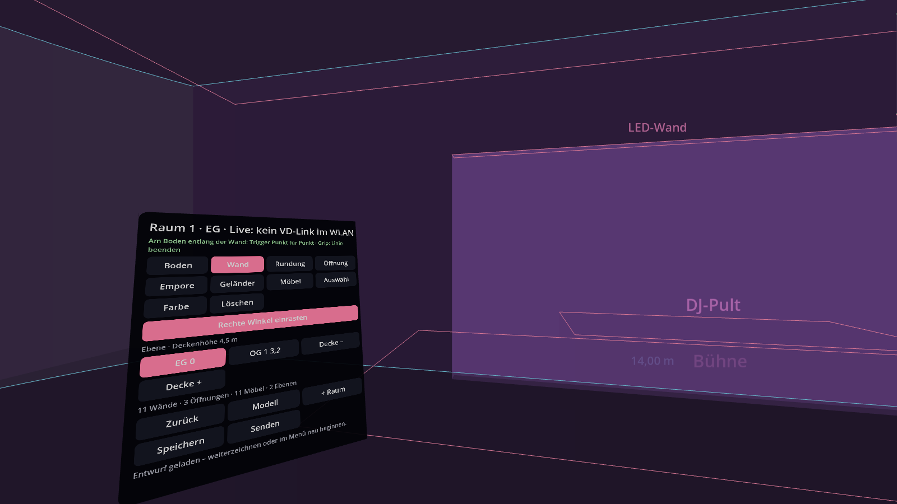
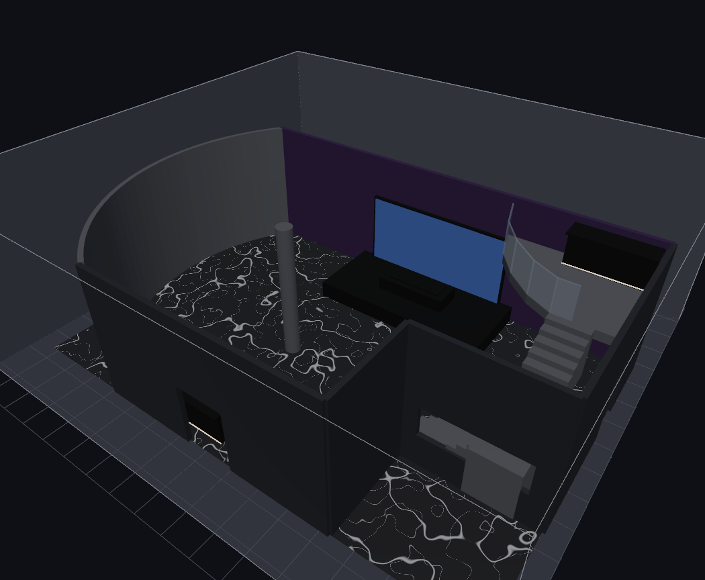

<p align="center">
  
</p>

<h1 align="center">VD VR</h1>

<h3 align="center">Steh mitten in deiner Lichtshow, bevor sie hängt.</h3>

<p align="center">
  Die VR-App zu <a href="https://github.com/skyplayser/VD-Link">VD-Link</a>: dein Club mit Lichtkegeln, Gobos, Haze und
  Videowänden in der Standalone-Brille –<br>live vom Computer, als Welt zum Begehen ohne Computer, und mit einem
  Club-Studio, in dem du den echten Club einzeichnest.
</p>

<p align="center">
  <a href="https://github.com/skyplayser/VD-VR/releases"></a>
  <a href="https://github.com/skyplayser/VD-VR/releases"></a>
  
  
  <a href="LICENSE"></a>
</p>

<p align="center">
  <a href="https://github.com/skyplayser/VD-VR/releases"></a>
  <a href="https://github.com/skyplayser/VD-Link/releases"></a>
</p>

<p align="center">
  
</p>

> **Alpha.** Entwickelt und getestet auf der **Pico 4 Ultra** (PICO OS 5.15) mit VD-Link 0.5 auf macOS. Eine Version
> für Meta Quest folgt später. Vieles ist neu und hat noch keinen echten Club gesehen – Rückmeldungen sind sehr
> willkommen.

---

## ✨ Was VD VR kann

<table>
<tr>
<td width="50%" valign="top">

### 🔴 Live aus VD-Link
Das Pult steuert VD-Link am Computer, VD-Link rechnet die Show, die Brille zeigt sie: Lichtkegel im Haze, Gobos, Lampenköpfe, Videowände. Jede Änderung in VD-Link ist sofort in der Brille. VD-Link zeigt dafür, wo die Brille steht und wohin sie schaut – mit **Mitschauen** und **Hierher holen**.

</td>
<td width="50%" valign="top">

### 🌍 Welten ohne Computer
**Welt auf Brillen übertragen**: Raum, Lampen, Videowände und das Licht des Moments landen auf der Brille. Danach läufst du ohne Computer durch den Club – für die Begehung mit dem Veranstalter, im Zug oder auf der Baustelle.

</td>
</tr>
<tr>
<td valign="top">

### 📐 Club-Studio
Den echten Club in der Brille nachzeichnen, durch die Kameras hindurch: Wände, Rundungen, Türen und Fenster, **Stockwerke, Emporen, Geländer und Treppen**, Möbel und die Materialien von VD-Link. VD-Link macht daraus eine Location zum Weiterbauen.

</td>
<td valign="top">

### 💻 Live am PC mitverfolgen
Während du in der Brille zeichnest, wächst der Club im Location-Builder von VD-Link mit – ohne die Ansicht zu verstellen. Die Brille findet den Computer im WLAN selbst wieder. Ohne Computer im Club: speichern und zu Hause senden.

</td>
</tr>
<tr>
<td valign="top">

### 🎬 Shows aufnehmen
Ein Stück Lichtshow aus VD-Link auf der Brille speichern (30 oder 60 s) und später ohne Computer abspielen. Dazu ein **Demo-Club** mit eigener Show, der schon beim ersten Start läuft.

</td>
<td valign="top">

### 🕹️ Gemacht für die Brille
72 fps auf der Pico 4 Ultra. Laufen mit Stufen bis 40 cm, Teleport, Drehen in Schritten oder gleitend, ein Startbildschirm wie in VD-Link, die Startanimation der Link-Suite in 3D um dich herum und ruhige Musik, damit man sich nicht so allein fühlt.

</td>
</tr>
</table>

<p align="center">
  
  
</p>
<p align="center">
  
  <br><sub>Im Club-Studio gezeichnet, in VD-Link als Location geöffnet: Halle mit Rundung, Empore mit Glasgeländer, L-Treppe mit Podest.</sub>
</p>

## 🚀 Loslegen

1. **VD-Link** ab 0.5 am Computer installieren ([Releases](https://github.com/skyplayser/VD-Link/releases)) und unter **VERBINDEN → VR-Brille** einschalten. VD-Link zeigt einen 4-stelligen Code.
2. **VD VR** auf die Pico: APK aus den [Releases](https://github.com/skyplayser/VD-VR/releases) laden und per USB installieren:
   ```bash
   adb install -r vd-vr-0.1.0-alpha-pico.apk
   ```
   (Entwicklermodus und USB-Debugging an; Schritt für Schritt in der [Anleitung](docs/ANLEITUNG.md#installieren).)
3. Brille und Computer ins **selbe WLAN**. In VD VR: **Mit VD-Link verbinden**, Computer wählen, Code eingeben.

Ohne Computer läuft sofort der **Demo-Club**. Alles Weitere – Bedienung, Welten, Club-Studio Werkzeug für Werkzeug –
steht in der **[Anleitung](docs/ANLEITUNG.md)**.

## 🛡️ Sicherheit

VR-Brillen verdecken die Welt. Im **Club-Studio** läufst du durch den echten Raum und siehst ihn nur durch die Kameras:
langsam gehen, auf Stufen, Treppen, Emporenkanten, Kabel und Menschen achten, am besten mit einer zweiten Person. Den
Spielbereich der Pico abzuschalten ist möglich, aber dann warnt dich nichts mehr vor Wänden – auf eigene Gefahr.
VD VR zeigt Licht nur an und steuert nichts. Strobe-Effekte können auch in der Brille schnell blitzen – Vorsicht bei
fotosensitiver Epilepsie.

## 🔒 Datenschutz

VD VR hat keine Konten, keine Werbung und keine Telemetrie. Die App spricht nur mit **deinem eigenen VD-Link** im
lokalen Netz (UDP-Suche im WLAN, HTTP). Welten, Shows und Zeichnungen bleiben auf der Brille, bis du sie selbst an
VD-Link schickst.

## 🧩 Teil der Link-Suite

VD VR gehört zur **[Link-Suite](https://link-suite.de/launcher/)** – Programme für Licht, Video und Show, die
zusammenpassen: [VD-Link](https://github.com/skyplayser/VD-Link) zeigt, wie alles zusammen aussieht,
[LJ-Link](https://github.com/skyplayser/LJ-Link) bringt Takt und Tempo an die Pulte,
[VJ-Link](https://link-suite.de/vj-link/) spielt die Visuals – und VD VR stellt dich mitten hinein.

## 🗺️ Als Nächstes

- [ ] Version für Meta Quest
- [ ] Club-Studio: Fotos der Wände als Texturen
- [ ] Mehrere Brillen gemeinsam im selben Club
- [ ] Installation und Updates über den Launcher Link-Suite

## 🛠️ Selbst bauen

<details>
<summary>Godot-Projekt, Export und Aufbau</summary>

Voraussetzungen: [Godot](https://godotengine.org/) 4.7.2 mit Android-Exportvorlagen, Android SDK, JDK 17.

1. Projekt im Godot-Editor öffnen.
2. **Godot OpenXR Vendors** 5.1.0 aus der AssetLib installieren (landet in `addons/godotopenxrvendors/`, nicht im Repo).
3. **Projekt → Android-Build-Vorlage installieren** (`android/`, nicht im Repo).
4. Optional die Hintergrundmusik ablegen, siehe [`music/README.md`](music/README.md).
5. Exportieren mit der Vorlage **Pico** (Release mit eigenem Schlüssel: `tools/build-release.sh`).

Am Desktop ohne Brille: `godot --path . --xr-mode off -- --demo` (Demo-Club), `-- --scan-fake` (Club-Studio mit
Beispiel-Club), `-- --server=http://<ip>:7700/<code>/` (live mit VD-Link).

```
scripts/      main.gd (Ablauf, Menüs), scan.gd (Club-Studio), net.gd (VD-Link, Welten), scenario.gd (Shows),
              venue.gd (Raum), walls.gd, home.gd (Lounge), intro.gd (Startanimation), music.gd, player.gd, menu.gd, art.gd
shaders/      Lichtkegel, Haze, Gobos, Videowände, Startanimation
demo/         Demo-Club (Aufnahme aus VD-Link)
intro/        Bilder und Klänge der Startanimation
licenses/     Lizenztexte, werden mit der App ausgeliefert
tools/        intro-sound.mjs (Klänge), make-release-key.sh (Signierschlüssel)
docs/         Anleitung, Bilder
```

**Technik:** Godot 4.7 (Compatibility-Renderer, OpenGL ES 3), OpenXR mit Passthrough fürs Club-Studio. VD-Link schickt den
Raum als eigenes Binärformat mit eingebackenem Licht, die Lampen und Videowände kommen live per HTTP/SSE. Die Lichtkegel
entstehen in einem Shader statt mit echten Lichtquellen, so bleibt es auf der Brille bei 72 fps.

</details>

## 🤝 Mitmachen

Fehler gefunden oder eine Idee? [Issue anlegen](https://github.com/skyplayser/VD-VR/issues/new/choose). Neue
Versionen und Show-Clips zuerst auf Instagram: [@nextphilm](https://www.instagram.com/nextphilm/).

## 📜 Lizenz

[Eclipse Public License 2.0](LICENSE) · Drittanbieter-Bausteine: [`THIRD_PARTY.md`](THIRD_PARTY.md) · Lizenztexte:
[`licenses/`](licenses/) · Musik: „Chill Out“ von atlasaudio (Pixabay), nur in der fertigen App.

Die Software wird kostenlos und ohne Gewähr bereitgestellt; es gelten die Haftungsregeln der EPL-2.0 im Rahmen des
deutschen Rechts. [Impressum](https://link-suite.de/impressum/) ·
[Datenschutz](https://link-suite.de/datenschutz/)

<sub>OpenXR™ ist eine Marke der Khronos Group Inc. PICO, Meta Quest und Godot sind Marken ihrer jeweiligen Inhaber.
VD VR ist ein unabhängiges Projekt und kein offizielles Produkt der genannten Hersteller. © 2026 Philipp Spruck /
NEXTPHILM</sub>
